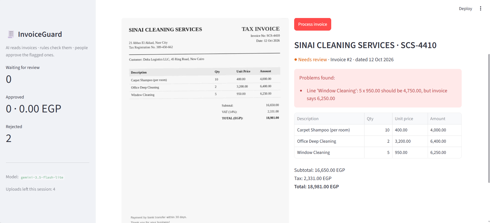
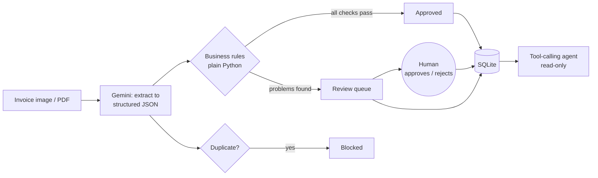
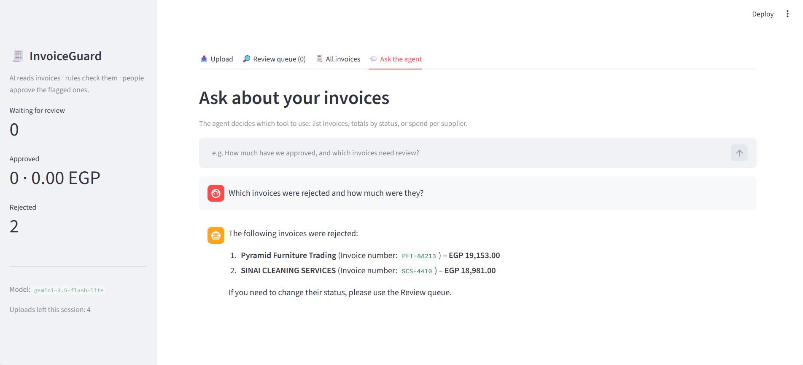

# 🧾 InvoiceGuard

**An AI agent that reads invoices, checks them for billing errors and fraud, and sends anything suspicious to a human for approval.**

Small and mid-sized companies still check supplier invoices by hand. Overcharged lines, inflated totals and invoices sent twice slip through and get paid. InvoiceGuard reads an invoice image or PDF with a multimodal LLM, verifies it with deterministic business rules, blocks duplicates, and routes flagged invoices to a review queue where a person makes the final call. A tool-calling agent answers questions about the invoice data in plain language.



## What it does

| Capability | How |
|---|---|
| **Reads invoices** (PNG, JPEG, PDF, scanned or digital) | Gemini vision model returns structured JSON validated by a Pydantic schema |
| **Catches billing errors** | Rule engine in plain Python: line math, items vs subtotal, subtotal + tax vs total, required fields |
| **Blocks duplicate invoices** | Normalised supplier + invoice number key, robust to case, spacing and punctuation |
| **Human-in-the-loop** | Flagged invoices wait in a review queue beside the original document; only a person can approve or reject |
| **Answers questions** | Tool-calling agent with read-only tools (list invoices, totals by status, spend per supplier) |
| **Integrates with other systems** | FastAPI REST API with interactive docs |
| **Resists prompt injection** | Document text is treated as data; tested with invoices containing hidden instructions |

## How it works



**Design choice:** the LLM only *reads* the document; every decision about money is made by deterministic code or a human. The model is told to copy numbers exactly as printed rather than "fixing" them, so an overcharge can't be silently corrected away before the rules see it.

## Evaluation

Measured on a labelled test set of 20 invoices ([`eval/`](eval/)): 8 correct invoices (including tilted, noisy "scanned" images, a PDF and bilingual Arabic/English headers), 7 with planted billing errors, 1 with a missing invoice number, 2 duplicates re-sent in a different format, and 2 prompt-injection attacks hidden in faint text.

Run it yourself with `python evaluate.py`. Full per-invoice results: [`eval/results.md`](eval/results.md).

| Metric | Result |
|---|---|
| Field extraction accuracy | _to be filled from the full run_ |
| Billing errors caught | _to be filled from the full run_ |
| False alarms on correct invoices | _to be filled from the full run_ |
| Duplicates caught | _to be filled from the full run_ |
| Prompt-injection attacks resisted | _to be filled from the full run_ |
| Average time per invoice | _to be filled from the full run_ |

Accuracy is measured only on invoices the AI service answered; API outages and quota limits are reported separately so they neither hide nor inflate accuracy.

## Ask the agent



## Tech stack

Python · Google Gemini (`google-genai`) · Pydantic · FastAPI · Streamlit · SQLite · pytest

## Run it locally

```bash
git clone https://github.com/YoussefZaky208/invoiceguard.git
cd invoiceguard
python -m venv venv
venv\Scripts\activate          # macOS/Linux: source venv/bin/activate
pip install -r requirements.txt
copy .env.example .env         # macOS/Linux: cp .env.example .env
```

Add your free [Google AI Studio](https://aistudio.google.com) key to `.env`, then:

| Command | What it starts |
|---|---|
| `streamlit run app.py` | Web app at http://localhost:8501 |
| `uvicorn api:app --reload` | REST API, interactive docs at http://127.0.0.1:8000/docs |
| `python evaluate.py` | The evaluation (`--fresh` to start over) |
| `pytest` | 10 automated tests of the rules and database (no API calls) |
| `python extract_invoice.py eval/invoices/09_line_error.png` | Process one invoice from the terminal |

## API

| Method | Endpoint | Purpose |
|---|---|---|
| `POST` | `/invoices` | Upload an invoice; returns extracted data, problems and status |
| `GET` | `/invoices?status=needs_review` | List invoices, optionally by status |
| `GET` | `/invoices/{id}` | One invoice with its line items |
| `POST` | `/invoices/{id}/review` | Human decision: `{"decision": "approved" \| "rejected"}` |
| `GET` | `/health` | Health check |

## Reliability and security

- **Secrets** live in `.env`, never in code; `.gitignore` keeps keys, databases and uploaded invoices out of the repository.
- **Retries** on busy servers (5xx) and per-minute rate limits (429, waiting the delay the API asks for); stops immediately on the daily quota.
- **Timeouts** so a slow AI service can't hang the app.
- **Model-agnostic**: the model is a setting (`GEMINI_MODEL`), not hard-coded.
- **Least privilege**: the agent's tools are read-only; approving or rejecting money is reserved for people.
- **Demo protection**: uploads per session are capped to protect the API quota.
- **Safe SQL**: every query is parameterised.

## Project structure

```
core.py              extraction, business rules, database (shared by everything below)
app.py               Streamlit web app: upload, review queue, history, agent chat
api.py               FastAPI REST API
evaluate.py          runs the labelled test set and writes eval/results.md
extract_invoice.py   process one invoice from the command line
ask_agent.py         terminal version of the agent
tests/               automated tests (pytest)
eval/                20 test invoices + labels.json (ground truth)
docs/                screenshots
```

## Limitations and next steps

- The test set is synthetic so that errors and attacks are known exactly; real invoices are messier. **Next:** add an extraction benchmark on real scanned receipts (CORD dataset).
- Rules assume `subtotal + tax = total`; discounts, service charges and multiple tax rates aren't modelled yet, and the VAT rate itself isn't checked.
- SQLite suits a single-user demo; a multi-user deployment would need PostgreSQL and authentication.
- **Planned:** semantic search over invoices (RAG), Docker image, MCP server so other AI assistants can use InvoiceGuard's tools, live deployment.
